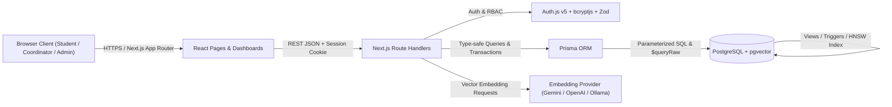
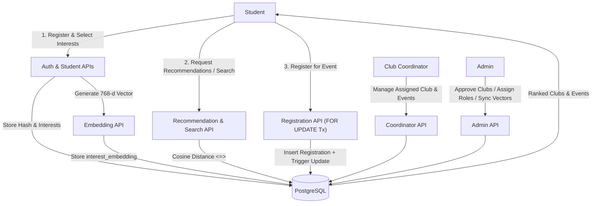
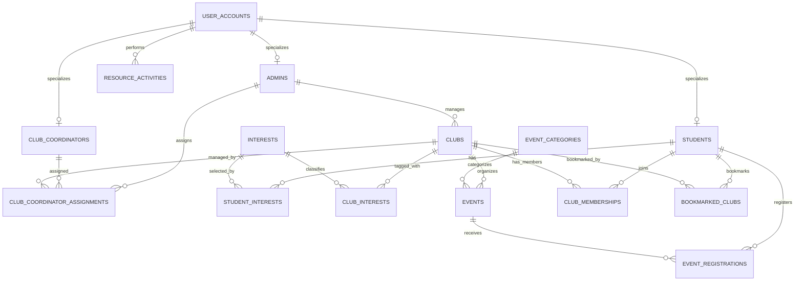
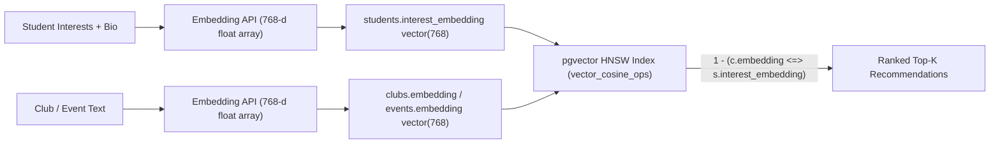

# ClubMatch — Smart College Club & Event Recommendation Platform
## DBMS Experiential Learning – Level 3 Academic Documentation

---

## 1. Project Title
**ClubMatch: Smart College Club & Event Recommendation Platform**  
*Tagline:* "Find Your People. Discover Your Passion."

---

## 2. Abstract
College students—especially incoming freshers and transfer students—frequently miss opportunities to join technical, cultural, non-technical, and research communities because information about campus clubs and upcoming events is fragmented across posters, messaging groups, and static pages. **ClubMatch** is a full-stack web application built with **Next.js (App Router)**, **TypeScript**, **Prisma ORM**, **PostgreSQL**, and **pgvector** that centralizes club discovery, interest-based semantic recommendations, and transactionally consistent event registration. Using a normalized Third Normal Form (3NF) relational schema alongside 768-dimensional semantic vector embeddings stored in PostgreSQL via `pgvector`, ClubMatch combines ACID-compliant relational operations with cosine-similarity vector retrieval inside a single unified database engine.

---

## 3. Problem Statement
Students struggle to identify campus clubs and events aligned with their personal and academic interests when club records, event announcements, and registration workflows are scattered across informal channels. Meanwhile, club coordinators lack a unified system to publish events, enforce seat capacities, and track student attendance, and administrators lack centralized oversight over club approvals, coordinator assignments, and engagement analytics.

---

## 4. Motivation
- **Information Fragmentation:** Students at PES University EC Campus have 40+ active technical clubs, non-technical clubs, cultural groups, and specialized research centers, making manual discovery overwhelming.
- **Keyword Blindness:** Traditional `LIKE` searches fail when a student's interest ("Deep Learning") uses different terminology than a club's description ("Neural Networks and Cognitive Computing").
- **Concurrency & Data Integrity:** Popular workshops and hackathons require atomic seat reservation with row-level locking to prevent overbooking and duplicate registrations.

---

## 5. Objectives
1. Build a centralized, role-based web platform for **Students**, **Club Coordinators**, and **Administrators**.
2. Design a normalized PostgreSQL relational database covering users, clubs, research centers, interests, events, memberships, bookmarks, and registrations.
3. Implement genuine semantic club and event recommendations using **pgvector** cosine similarity (`<=>`) and HNSW indexing, with a transparent documented fallback when external embedding credentials are absent.
4. Demonstrate advanced DBMS concepts: **ACID Transactions (`FOR UPDATE`)**, **SQL Views**, **PostgreSQL Triggers**, **B-Tree/GIN/HNSW Indexing**, **pgvector Similarity Search**, and **Aggregate/Subquery Analytics**.
5. Enforce server-side authentication, bcrypt password hashing, Zod validation, and strict RBAC.

---

## 6. Scope
- **Campus Seed Reference:** Initialized with 41 PES University EC Campus student clubs and research centers (referenced from PESUfy EC Campus directory as sample initial data) and 25 curated interest domains.
- **Role Workflows:** Student onboarding & discovery, Coordinator club/event management scoped strictly to assigned clubs, and Admin platform governance & live DBMS inspection.
- **Boundary:** ClubMatch focuses strictly on club discovery, semantic recommendations, and event registration—not general university ERP/academics.

---

## 7. Functional Requirements
1. **Authentication & RBAC:** Public student registration (`STUDENT` role locked), Auth.js credentials sign-in, role-restricted dashboards and APIs.
2. **Interest Selection & Onboarding:** Multi-select interactive interest cards stored in `student_interests`, editable anytime.
3. **Club & Research Center Directory:** Categorized browsing (`TECHNICAL`, `NON_TECHNICAL`, `CULTURAL`, `RESEARCH_CENTER`), keyword search, semantic search, interest/campus filtering, bookmarking, and individual detail pages with similar communities.
4. **Event Discovery & Registration:** Event directory with category/club/date filters, atomic registration transaction (`POST /api/events/[id]/register`), duplicate prevention, cancellation (`DELETE`), and history tracking.
5. **Personalized Recommendations:** Student dashboard sections for *Recommended Clubs for You*, *Events You Might Like*, *Saved Clubs*, and *Active Registrations*.
6. **Coordinator Portal:** Manage assigned clubs, create/edit/cancel events, manage capacities, and mark student attendance.
7. **Admin Console:** Approve/reject pending clubs, assign coordinators, manage user roles, manage interests, view analytics, and inspect live PostgreSQL views/triggers/indexes.

---

## 8. Non-Functional Requirements
- **Security:** Passwords hashed with `bcryptjs` (cost factor 12), parameterized SQL/Prisma queries preventing SQL injection, Zod schema validation on all inputs, zero secret exposure.
- **Data Integrity:** Primary keys, foreign keys with `ON DELETE` rules, composite PKs on M:N tables, `UNIQUE(student_id, event_id)`, and DB-level `CHECK` constraints (`semester`, `max_capacity`, `registration_deadline <= event_date`).
- **Usability & Accessibility:** Responsive mobile-first Tailwind UI with Light and Dark themes, loading states, empty states, and toast notifications.

---

## 9. Technology Stack
| Layer | Technology | Purpose |
| :--- | :--- | :--- |
| Frontend | Next.js 15 (App Router), React 19, TypeScript | SSR/CSR pages, routing, typed UI |
| Styling & Icons | Tailwind CSS, Lucide React | Responsive light/dark UI & icons |
| Backend API | Next.js Route Handlers (`app/api/**`) | REST endpoints, RBAC, transactions |
| ORM | Prisma ORM (`@prisma/client`) | Type-safe relational queries & migrations |
| Primary DB | PostgreSQL | ACID relational storage, views, triggers |
| Vector Search | `pgvector` (`vector(768)` + HNSW) | Cosine similarity semantic search |
| Auth & Security | Auth.js / NextAuth v5, `bcryptjs`, `zod` | JWT sessions, hashing, validation |
| Testing | Vitest + PGlite (`vector` extension) | Automated DB, pgvector & security tests |

---

## 10. System Architecture

### Data-Flow Diagram (DFD Level 1)

---

## 11. ER Diagram (Actual Implemented Schema)

---

## 12. Relational Schema
- **user_accounts**(`user_id` PK, `email` UNIQUE, `password_hash`, `full_name`, `role`, `is_active`, `created_at`, `updated_at`)
- **students**(`student_id` PK, `user_id` UNIQUE FK → `user_accounts`, `email` UNIQUE, `srn` UNIQUE, `department`, `semester` CHECK 1..8, `campus`, `bio`, `onboarding_completed`, `interest_embedding` `vector(768)`, `embedding_model`, `embedding_updated_at`)
- **admins**(`admin_id` PK, `user_id` UNIQUE FK → `user_accounts`, `email` UNIQUE, `designation`)
- **club_coordinators**(`coordinator_id` PK, `user_id` UNIQUE FK → `user_accounts`, `email` UNIQUE, `department`, `phone`)
- **clubs**(`club_id` PK, `slug` UNIQUE, `name` UNIQUE, `category`, `campus`, `tagline`, `description`, `activities`, `is_sample_description`, `verified_coordinator_name`, `verified_email`, `status`, `is_featured`, `member_count` CHECK >= 0, `admin_id` FK → `admins`, `embedding` `vector(768)`)
- **event_categories**(`category_id` PK, `name` UNIQUE, `slug` UNIQUE, `description`)
- **events**(`event_id` PK, `slug` UNIQUE, `title`, `description`, `club_id` FK → `clubs`, `category_id` FK → `event_categories`, `event_date`, `start_time`, `end_time`, `venue`, `registration_deadline` CHECK <= `event_date`, `max_capacity` CHECK > 0, `current_registrations` CHECK 0..`max_capacity`, `status`, `is_featured`, `is_sample_event`, `embedding` `vector(768)`)
- **interests**(`interest_id` PK, `interest_name` UNIQUE, `slug` UNIQUE, `category`, `description`, `icon_name`)
- **student_interests**(`student_id` FK, `interest_id` FK, **PK(`student_id`, `interest_id`)**)
- **club_interests**(`club_id` FK, `interest_id` FK, `weight`, **PK(`club_id`, `interest_id`)**)
- **event_registrations**(`registration_id` PK, `student_id` FK, `event_id` FK, `status`, `registered_at`, `cancelled_at`, **UNIQUE(`student_id`, `event_id`)**)
- **club_memberships**(`student_id` FK, `club_id` FK, `role`, `status`, `joined_at`, **PK(`student_id`, `club_id`)**)
- **bookmarked_clubs**(`student_id` FK, `club_id` FK, `created_at`, **PK(`student_id`, `club_id`)**)
- **club_coordinator_assignments**(`coordinator_id` FK, `club_id` FK, `assigned_by_admin_id` FK, `title`, `assigned_at`, **PK(`coordinator_id`, `club_id`)**)
- **resource_activities**(`activity_id` PK, `actor_user_id` FK, `actor_role`, `action`, `entity_type`, `entity_id`, `summary`, `metadata`, `created_at`)

---

## 13. Data Dictionary
Key attributes and constraints are defined in [`prisma/schema.prisma`](../prisma/schema.prisma) and [`database/sql/schema.sql`](../database/sql/schema.sql):
- **Composite Primary Keys:** `(student_id, interest_id)`, `(club_id, interest_id)`, `(student_id, club_id)` on bookmarks & memberships, and `(coordinator_id, club_id)`.
- **Domain & Check Constraints:** `semester BETWEEN 1 AND 8`, `max_capacity > 0`, `current_registrations BETWEEN 0 AND max_capacity`, `registration_deadline <= event_date`.
- **Vector Columns:** `interest_embedding vector(768)` on `students`, `embedding vector(768)` on `clubs` and `events`.

---

## 14. Database Normalization
- **1NF:** All columns store atomic values; multi-valued student interests and club tags are separated into `student_interests` and `club_interests`.
- **2NF:** Every non-key attribute in composite-key junction tables (`club_interests.weight`, `club_memberships.role`, `club_coordinator_assignments.title`) depends on the entire composite key.
- **3NF:** Transitive dependencies are eliminated—e.g., `event_categories` is separated from `events`, `interests` metadata is separated from junction tables, and authentication credentials live on `user_accounts` rather than being duplicated across student/coordinator/admin entities.

---

## 15. PostgreSQL Justification
ClubMatch's core domain is strictly relational: students, clubs, events, interests, coordinator assignments, and event registrations rely on foreign key integrity, unique constraints (`UNIQUE(student_id, event_id)`), and ACID row-level locking (`SELECT ... FOR UPDATE`) to prevent overbooking. NoSQL stores lack native multi-table relational integrity and declarative `CHECK` constraints across these entities.

---

## 16. pgvector Justification
Rather than operating a separate vector database (Pinecone/Qdrant/Chroma) alongside PostgreSQL—which introduces dual-write sync bugs and distributed joins—`pgvector` embeds vector storage and cosine similarity indexing directly inside PostgreSQL. This enables single-query joins combining `WHERE status = 'ACTIVE'` relational filters with `ORDER BY embedding <=> $1` vector ranking.

---

## 17. Embedding Model and Methodology
- **Data Embedded:**
  - *Students:* Selected interest names, categories, and optional student bio.
  - *Clubs:* Name, category, tagline, description, activities, and linked interest topics.
  - *Events:* Title, category, organizing club name, venue, and description.
- **Embedding Providers (768 dimensions):** Configurable via environment variables (`GEMINI_API_KEY` → `gemini-embedding-001` with `outputDimensionality: 768`; `OPENAI_API_KEY` → `text-embedding-3-small` with `dimensions: 768`; or local Ollama `nomic-embed-text`).
- **Honest Fallback:** If no embedding API key or Ollama endpoint is configured, ClubMatch never generates random vectors or fabricated scores; it explicitly surfaces `semanticAvailable: false` and falls back to relational `student_interests ⋈ club_interests` overlap ranking.

---

## 18. Vector Storage and Retrieval

- **Why Cosine Similarity:** Text embedding vectors vary in length depending on description verbosity; cosine distance (`<=>` in pgvector) measures angular alignment (`1 - cosine_similarity`), focusing purely on topical meaning rather than text length.
- **Keyword vs Semantic Search:** Keyword search (`ILIKE` / PostgreSQL GIN `to_tsvector`) matches exact tokens (`"cybersecurity"`), whereas semantic search maps related concepts (`"ethical hacking"` ↔ `"network defense"` ↔ `"Layer8"`).

---

## 19. SQL Implementation
All DDL, DML, DQL, Views, Triggers, Indexes, Transactions, and pgvector queries are maintained in [`database/sql/`](../database/sql/):
- `schema.sql`: `CREATE EXTENSION vector`, `CREATE TYPE`, `CREATE TABLE`, `ALTER TABLE ... ADD CONSTRAINT`
- `advanced_queries.sql`: `CREATE/ALTER/DROP` snapshot demo, `INNER JOIN`, `LEFT JOIN`, `GROUP BY`, `HAVING`, `ORDER BY`, `COUNT`, `SUM`, `AVG`, and correlated subqueries.

---

## 20. Advanced DBMS Concepts Implemented
1. **Transactions (`transactions.sql`, `app/api/events/[id]/register/route.ts`):** `prisma.$transaction` + `SELECT ... FOR UPDATE` row-level lock guaranteeing zero overbooking under concurrent registrations, with full rollback on error.
2. **Views (`views.sql`):** `v_popular_clubs`, `v_event_registration_stats`, `v_club_event_summary`, `v_student_registration_summary`.
3. **Triggers (`triggers.sql`):** `trg_*_updated_at`, `trg_sync_event_registration_count` (auto-updates `current_registrations` & logs into `resource_activities`), `trg_sync_club_member_count`, `trg_log_club_status_change`.
4. **Indexing (`indexes.sql`):** B-Tree indexes on emails, dates, foreign keys, and composite status lookups; GIN full-text search indexes; and pgvector HNSW indexes (`vector_cosine_ops`, `m=16, ef_construction=64`).
5. **Vector Similarity Search (`vector_search.sql`, `lib/recommendations.ts`):** Cosine distance queries across clubs, events, and similar communities.

---

## 21. API Documentation
| Method | Endpoint | Auth / Role | Description |
| :--- | :--- | :--- | :--- |
| POST | `/api/auth/register` | Public | Registers a `STUDENT` (role locked) |
| POST/GET | `/api/auth/[...nextauth]` | Public | Auth.js credentials login/session |
| GET/POST | `/api/interests` | Public / `ADMIN` | List or create interests |
| GET/PATCH | `/api/students/profile` | `STUDENT` | Read/update student profile |
| GET/PUT | `/api/students/interests` | `STUDENT` | Save selected interests + sync vector |
| GET/POST/DELETE | `/api/students/bookmarks` | `STUDENT` | Manage bookmarked clubs |
| GET | `/api/students/registrations` | `STUDENT` | Student registration history |
| GET | `/api/students/dashboard` | `STUDENT` | Aggregated student dashboard data |
| GET/POST | `/api/clubs` | Public / `ADMIN`, `COORDINATOR` | Search/filter clubs or create/submit |
| GET/PATCH/DELETE | `/api/clubs/[id]` | Public / `ADMIN`, assigned `COORDINATOR` | Club details, edit, deactivate |
| POST/DELETE | `/api/clubs/[id]/membership` | `STUDENT` | Join or leave an active club |
| GET/POST | `/api/events` | Public / `ADMIN`, assigned `COORDINATOR` | Filter events or create event |
| GET/PATCH/DELETE | `/api/events/[id]` | Public / `ADMIN`, assigned `COORDINATOR` | Event details, edit capacity, cancel |
| POST/DELETE | `/api/events/[id]/register` | `STUDENT` | Atomic registration & cancellation |
| GET/POST | `/api/recommendations` | `STUDENT` | Personalized clubs & events |
| GET/POST | `/api/search/semantic` | Public | pgvector semantic search |
| GET | `/api/coordinator/dashboard` | `CLUB_COORDINATOR` | Scoped assigned club dashboard |
| PATCH | `/api/coordinator/registrations` | `CLUB_COORDINATOR`, `ADMIN` | Mark attended/cancelled |
| GET | `/api/admin/overview` | `ADMIN` | Platform KPIs, pending clubs, logs |
| GET/PATCH | `/api/admin/users` | `ADMIN` | Role & account governance |
| GET/POST/DELETE | `/api/admin/coordinators` | `ADMIN` | Assign coordinators to clubs |
| GET | `/api/admin/db-showcase` | `ADMIN` | Live SQL Views & DBMS metadata |
| POST | `/api/embeddings/sync` | `ADMIN` | Batch pgvector embedding sync |

---

## 22. Authentication and Authorization
- **Password Security:** `bcryptjs` (salt rounds = 12) hashes every password before persistence.
- **Session Strategy:** Auth.js v5 JWT session storing `userId`, `role`, `studentId`, `coordinatorId`, `adminId`.
- **RBAC Enforcement:** Every protected API handler calls `requireRole([...])` and coordinators additionally pass `verifyCoordinatorClubAccess(coordinatorId, clubId)` so they can never modify unassigned clubs or events.

---

## 23. Testing Methodology
Automated verification is implemented with **Vitest** across three test suites:
1. `tests/db-and-pgvector.test.ts` — Executes the real PostgreSQL SQL files (`schema.sql`, `views.sql`, `triggers.sql`, `indexes.sql`, `advanced_queries.sql`) against an embedded PostgreSQL + `pgvector` engine (`@electric-sql/pglite` with `vector` extension).
2. `tests/api-and-security.test.ts` — Verifies Zod validation schemas, bcrypt password hashing, deadline checks, role escalation rejection, embedding unavailability honesty, and SQL injection guards on vector literals.
3. `tests/e2e-prisma-and-api.test.ts` — Connects real `PrismaClient` over `PGLiteSocketServer` (`pgvector`) to verify idempotent seeding of all 41 PESU ECC clubs / 25 interests / 8 categories, Next.js Route Handlers with RBAC, club membership transactions, atomic `FOR UPDATE` event registration concurrency (`1` seat vs 2 students), admin DBMS view endpoints, and `pgvector` cosine distance ranking.

---

## 24. Test Cases and Results
| Test Case | Verification Scope | Observed Result |
| :--- | :--- | :--- |
| DB-01 | `CHECK` constraints (`semester 1..8`, `registration_deadline <= event_date`) | Passed (invalid inserts rejected) |
| DB-02 | Trigger `trg_sync_event_registration_count` & `UNIQUE(student_id, event_id)` | Passed (count updated, duplicate rejected, audit logged) |
| DB-03 | ACID `BEGIN ... ROLLBACK` transaction atomicity | Passed (rolled-back bookmark absent) |
| DB-04 | Views (`v_popular_clubs`, `v_event_registration_stats`) & `advanced_queries.sql` | Passed |
| DB-05 | Real `pgvector` `<=>` cosine similarity ranking | Passed (`NeuralHive` 1.0 > `Layer8` > `Terpsichore` 0.0) |
| SEC-01 | Registration password strength & email normalization | Passed |
| SEC-02 | `bcryptjs` hashing & verification | Passed |
| SEC-03 | Event deadline > event date rejection | Passed |
| SEC-04 | Invalid club category & role escalation (`SUPERUSER`) rejection | Passed |
| SEC-05 | No fake embeddings generated when API key missing | Passed |
| SEC-06 | Vector literal validation (`NaN` & wrong dimensions rejected) | Passed |
| SEC-07 | URL-safe slug generation | Passed |
| E2E-01 | Idempotent upsert of 41 clubs, 25 interests & 8 event categories | Passed |
| E2E-02 | Public/Student isolation of `PENDING` clubs vs `ADMIN` visibility | Passed |
| E2E-03 | Student join/leave club membership transaction & `memberCount` sync | Passed |
| E2E-04 | Atomic 1-seat event registration concurrency (`201` vs `409`), duplicate block & cancel/re-register | Passed |
| E2E-05 | Coordinator assigned-club RBAC & Admin DBMS showcase views (`v_club_event_summary`, `v_student_registration_summary`) | Passed |
| E2E-06 | Honest `semanticAvailable: false` fallback & Prisma `<=>` cosine ordering | Passed |

---

## 25. Application Screenshots
Capture screenshots during local demonstration after running `npm run dev` on `http://localhost:3000`:
1. Homepage (Light & Dark themes)
2. Interest Onboarding (`/onboarding`)
3. Club Directory with Keyword vs Semantic Search (`/clubs`)
4. Event Detail & Transactional Registration (`/events/[slug]`)
5. Student Dashboard (`/dashboard/student`)
6. Coordinator Dashboard (`/dashboard/coordinator`)
7. Admin Console & DBMS Inspector (`/dashboard/admin`)

---

## 26. Limitations
- Initial PESU EC Campus club descriptions, member counts, and sample events are demonstration placeholders (`isSampleDescription = true`, `isSampleEvent = true`), and official coordinator contacts remain unverified until updated by administrators.
- Semantic vector search requires configuring an embedding provider (`GEMINI_API_KEY`, `OPENAI_API_KEY`, or local Ollama `nomic-embed-text`); without one, the platform transparently operates in relational interest-overlap fallback mode.

---

## 27. Conclusion
ClubMatch demonstrates how a real-world campus discovery problem is solved by pairing a strictly normalized 3NF PostgreSQL database with `pgvector` semantic similarity search inside a modern Next.js full-stack application.

---

## 28. Future Enhancements
- Automated team-formation matching for hackathons using student skill vectors.
- QR-code check-in scanner for club coordinators during live events.
- Calendar export (`.ics`) and email/push reminders before registration deadlines.
